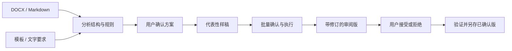

# DocxFormat


[](LICENSE)


**根据 DOCX 模板或文字要求，规范已有 Word 文档，或把 Markdown 转成可编辑 DOCX。**

默认保留原文和特殊对象，以 Word 原生格式修订交付审阅版。Agent 负责理解要求与采访确认，脚本负责确定性的修改和验证。

> 论文、公文、红头、三线表、目录分别处理。支持程度按“保留、规范化、新建、验证”区分，不把保存成功当作排版完成。

## 使用场景

```text
按照这份学校模板整理论文，正文内容不动。
先给出方案，保留公式与引用，输出带修订的审阅版。

这批公文使用同一套模板。先做一份样稿让我确认，
保留红头的字距、缩放和图形效果，再处理剩余文件。

把报告.md 转成 Word，正文宋体小四、1.5 倍行距，
表格用三线表。目录生成后告诉我是否已经更新页码。
```

## 红头案例

下面四组均由**可编辑 DOCX 实际渲染**，经过 Skill 的模板组件迁入流程。机关名称与正文为原创虚构内容。


| 案例 | 展示的原生元素 | 完整页面 |
| --- | --- | --- |
| 常规红头 | 居中红色机关标志、发文字号、单红线 | [查看](docs/assets/letterheads/01-classic.webp) |
| 长名称与字距 | 78% 横向缩放、1.2 磅字符间距 | [查看](docs/assets/letterheads/02-condensed.webp) |
| 联合发文组合 | 双机关名称、合并单元格布局、“文件”居中、双红线 | [查看](docs/assets/letterheads/03-joint.webp) |
| 空心描边效果 | 原生空心文字、英文副行、双红线 | [查看](docs/assets/letterheads/04-outline.webp) |

这些是效果保留与迁入案例，**不是 GB/T 9704 合规样板**；空心描边也不代表任意艺术字都可重建。四组已在同一 LibreOffice 环境中检查完整页面，独立参考排版与迁入预览的渲染像素一致；Word／WPS 仍需分别复核。

[案例参数、使用示例与复现方法 →](docs/LETTERHEAD-CASES.md)

### 拉伸与字距对照

同一组文字按相同比例展示：**原比例 → 横向拉宽 150% → 横向压缩 70% → 瘦长效果 → 仅加大字距**。所有字形均来自真实 DOCX 渲染，保持可编辑。


瘦长效果采用 **54 磅字号＋67% 横向缩放**，与 36 磅原比例字宽接近、高度增加；它不是独立的纵向缩放属性。字距示例只增加间隔，不改变字形宽高比例。

该例由 Skill 的原生格式修订流程生成，图片展示接受效果的临时验证副本；审阅版仍保留待审修订。[查看完整页面](docs/assets/letterheads/05-stretch.webp) · [复现方法](docs/LETTERHEAD-CASES.md#拉伸对照的复现)

## 工作方式



单文件可以省略批量样稿环节。复杂红头或结构重建先提供独立效果预览；方案确认和样稿确认都**不等于接受最终修订**。

## 核心能力

| 能力 | 实际行为 |
| --- | --- |
| 模板与文字规则 | 提取格式观测，Agent 解决冲突，形成有来源的规则和修改计划 |
| 原生格式修订 | 字体、段落、节、表格、行和单元格属性留痕；按本轮范围接受／拒绝 |
| 内容与对象保护 | 默认保持原文、媒体、公式、域、书签、批注、历史修订及复杂对象 |
| 三线表 | 明确表头范围，处理表格及单元格边框，保留合并与数据 |
| 目录 | 保留已有目录；可在明确位置创建真实 TOC 域，页码更新另行核验 |
| 红头组件 | 保留原生对象，或经预览确认后迁入指定模板块及其依赖 |
| Markdown | 标题 1—6 级、真实列表、表格、代码、链接、图片、脚注、复选框、常见公式 |
| 批量任务 | 文件隔离、分组样稿、独立失败、输入和输出哈希校验、恢复执行 |

完整边界见 [能力矩阵](skills/docx-format/references/capabilities.md)。

## 安装

需要 **Python 3.11+**。在仓库中使用时，Codex 和 Claude Code 的项目入口已指向同一份 Skill。

```bash
git clone https://github.com/zhoucanzong/DocxFormat.git
cd DocxFormat
python3 -m venv .venv
source .venv/bin/activate
python -m pip install -r skills/docx-format/requirements.txt
```

Windows 激活命令为 `.venv\Scripts\Activate.ps1`。请让 Agent 使用装有依赖的解释器。
如果 Windows 的 Git 没有启用符号链接，请使用下面的完整文件夹复制安装方式；不要把链接文本文件当成已经安装的 Skill。

也可以把整个 `skills/docx-format/` 文件夹复制到个人技能目录：

| 平台 | 个人目录 | 调用 |
| --- | --- | --- |
| Codex | `~/.agents/skills/docx-format/` | `$docx-format` 或自然语言匹配 |
| Claude Code | `~/.claude/skills/docx-format/` | `/docx-format` 或自然语言匹配 |

Skill 自包含；无需额外服务或 LLM API 密钥。字体和用于视觉检查的 Word、WPS 或 LibreOffice 由运行环境提供。

## 交付与修订

默认输出包含：

- **审阅版 DOCX**：本轮原生修订保持待审状态。
- **变更摘要**：说明修改、保留和未解决的区域。
- **执行记录**：保存计划、用户决定、修订范围及校验结果。
- **批量汇总**：每份文件独立显示处理与审阅状态。

用户确认后，接受获准修订并另存已确认版。原稿、审阅版和历史修订不会被无差别覆盖或清除。

红头迁入、目录插入等复杂结构动作使用**独立预览确认**，不冒充可逐条撤销的原生格式修订。首次 Markdown 生成先建立语义基线，再记录排版阶段的修订。

## 面向开发者的入口

```bash
python skills/docx-format/scripts/docx_format.py --help

# 只读检查
python skills/docx-format/scripts/docx_format.py inspect manuscript.docx --out work/inspection.json

# 提取候选规则；冲突仍需要 Agent 和用户判断
python skills/docx-format/scripts/docx_format.py extract-template template.docx --out work/template.json

# Markdown 语义基线，之后进入相同的修订流程
python skills/docx-format/scripts/docx_format.py markdown examples/report.md --out work/baseline.docx
```

具体流程：

- [规则与模板](skills/docx-format/references/rules.md)
- [关键点采访](skills/docx-format/references/interview.md)
- [原生修订](skills/docx-format/references/revisions.md)
- [批量处理](skills/docx-format/references/batch.md)
- [论文](skills/docx-format/references/thesis.md) · [公文与标准](skills/docx-format/references/official-documents.md)
- [三线表](skills/docx-format/references/tables.md) · [目录](skills/docx-format/references/toc.md) · [红头](skills/docx-format/references/letterhead.md)

命令中的 `--confirmation` 用于记录用户已经给出的答复，**不能由 Agent 自行编造来绕过确认**。

## 标准与验证

项目维护带版本的 [标准资料登记](skills/docx-format/assets/standards.json)，区分国标条款、学校／单位要求、模板观测与用户决定。

GB/T 9704 公文基础方案只是明确标注范围的候选规则；论文以适用学校或期刊要求为准。标点、数字和参考文献内容不会因排版任务被自动重写。

验证分为内容保护、包结构与关系、计划规则、视觉效果。字段已创建不等于页码已更新，字体名已设置不等于实际字体已验证。具体测试范围及剩余限制见 [验证记录](docs/QA.md)。

## 开发与打包

```bash
python -m pip install -r requirements-dev.txt
python -m pytest -q tests
python tools/check_release.py
python tools/package_skill.py --out dist/docx-format.zip
```

生成的压缩包只包含独立 Skill 及许可，不包含本地调研材料、用户文件或测试输出。

## 项目结构

```text
skills/docx-format/   Skill、执行工具、参考说明与规则
tests/               内容保留、修订、组件与工作流回归
examples/            原创演示输入
tools/               发布检查、打包和测试样例生成
docs/                设计、实施与验证记录
```

## 许可

本项目采用 [Apache License 2.0](LICENSE)。安装的第三方依赖遵循各自许可；它们的代码不被重新声明为本项目许可。
