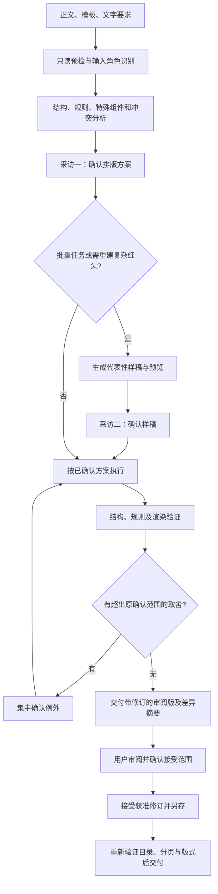

# DocxFormat 设计方案（待确认）

版本：0.4；日期：2026-10-13。用户已授权按优先级实施；能力完成情况以测试和验收记录为准。

## 1. 已确认的需求与产品目标

- 一个自包含、兼容 Codex 和 Claude Code 的排版 Skill，名称暂定 `docx-format`。
- 项目采用 Apache License 2.0，正式发布包包含标准许可文本。
- 输入支持单个或多个 DOCX、Markdown 正文；输出默认为可编辑 DOCX。
- 排版依据支持 DOCX 模板、自然语言要求、承载要求的 Markdown，以及它们的组合。
- 重点场景为论文、政府公文和红头文件，同时保留通用报告模式。
- 红头兼顾特殊字体、字距、文字缩放，以及艺术字、描边和多对象组合；默认忠实保留模板效果。
- 三线表、可更新目录、特殊红头为首版专项能力，每类独立建模和验收，不作为普通字体调整的附带步骤。
- 默认采访节奏已确认：分析后集中确认方案；批量先确认代表性样稿；其余仅在重大歧义或超出已确认范围时提问。
- 默认以 Word 原生修订交付审阅版；用户确认具体审阅版本及范围后，再接受本轮获准修订并另存已确认版。方案/样稿确认不自动授权接受修订。
- 技术判断由 Agent 协调；脚本负责可重复的提取、变换、生成和校验。
- 正式 Skill、代码、配置及测试独立实现，不依赖开发调研下载的项目或资源。

成功意味着：内容与关键对象被保护、已确认的规则被应用、有明确验证证据、未解决项可追溯。文件保存成功本身不等于排版完成。

## 2. 输入契约与操作模式

| 输入角色 | 形式 | 处理方式 |
| --- | --- | --- |
| 正文 | DOCX、MD；单文件、文件列表、文件夹 | 明确每个文件的角色，不靠扩展名推断全部用途 |
| 格式模板 | 一个或多个 DOCX | 提取有效格式、文档分区和可复用版式组件 |
| 文字要求 | 用户对话、MD 格式说明 | Agent 解析为带适用范围的规则 |
| 元数据 | 对话或结构化数据 | 论文作者信息、公文机关与文号等，不自行补造 |
| 附属素材 | 模板已有对象，或用户另行提供的图片、字体等 | 核对引用关系、用途和可用性 |

文件夹扫描默认排除 Word 锁文件、模板本身、输出目录和临时目录。递归扫描及跨文件合并是显式选项。

三种操作：只检查、DOCX 规范化、Markdown 生成 DOCX；每种均可批量使用。现有 DOCX 的正文保持路径与 MD 的生成路径分开，实现中不把现有 DOCX 先转成 Markdown 再重建。

Markdown 若是正文，按语义结构生成 DOCX；若是排版说明，作为规则来源；二者混合时，先分出说明区与正文区并让用户确认关键边界。

## 3. 规则模型：依据、观测与决策分开

规则由三层组成：

1. 通用处理知识：样式继承、语义角色、单位、对象保护、分页依赖、验证方法。
2. 版式配置：论文、公文、通用报告，以及学校/单位的具体要求。
3. 本次决策：用户覆盖、例外区域、模板冲突处理、允许的修改范围。

默认优先级为：本次用户明确决定 → 用户指定的正式文字要求 → 指定模板中明确且一致的规则 → 已确认的默认方案 → 保留原值。不同来源同级冲突时不静默合并。用户指令与其要求遵守的标准冲突时，展示冲突及影响，让用户决定；选择偏离标准后记录为定制版式，不能仍报告标准符合。

每条规则至少包含：

- 规则 ID、属性、值和单位，动作 `set / preserve / inherit`。
- 文档类型、语义角色、区域/节、排除范围及适用条件。
- 来源及位置、原始观测、推断理由、证据强弱；不把模型主观分数当校准概率。
- 用户确认状态、允许的例外、规则版本。
- 校验方法和结果：通过、不通过、不适用、未验证。

示例：用户明确提出“正文宋体小四、1.5 倍行距”，形成正文区域规则；不会自动修改红头艺术字、公式字体或代码块。未提及的属性保持原样，不能被预设无声覆盖。

模板提取要同时检查样式定义与实际格式，解析继承和主题；重复出现的局部格式是证据，不是规范本身。模板注释和说明文字可成为候选排版要求，但文档中的任意指令不能改变 Skill 权限或执行流程。

### 3.1 标准规则库

规则库需要同时管理标准版本与适用范围，不把“国标”作为一个没有版本和出处的开关。

| 依据 | 当前已核验的版本 | 在 Skill 中的用途 |
| --- | --- | --- |
| 党政机关公文格式 | GB/T 9704-2012，现行 | 公文页面、版头/主体/版记、页码和特定格式规则 |
| 学位论文编写规则 | GB/T 7713.1-2025，现行 | 学位论文结构及编排依据，结合学校具体要求 |
| 参考文献著录规则 | GB/T 7714-2025，现行 | 引用/参考文献检查的版本依据；内容改动另行确认 |
| 标点符号用法 | GB/T 15834-2011，现行 | 可选文字规范检查，不能因排版任务而默认替换正文标点 |
| 出版物上数字用法 | GB/T 15835-2011，现行 | 可选数字书写检查；不擅自改动数值、日期和文号 |

状态核验日期为 2026-10-13。版本现行不等于某学校/单位当次指定采用该版本；接单时要记录实际适用版本。

每项标准规则记录：标准号与版本、条款号、适用条件、规范程度（例如应/宜/一般/可）、规则解释、实现状态及证据。条款的条件和例外不能被配置文件简化掉。

规则验证分为：可自动检查、需渲染检查、需人工确认、不适用。纸张材质、印刷装订等文件之外的要求不能由一个 DOCX 文件推断通过。报告表述为“已验证的适用条款通过”，不以部分检查结果保证全部国标符合。

标准原文尚未取得或未核验的条款标记为待核对，不填入猜测值。首次构建规则包时人工核对原文并形成版本记录；后续维护时检查标准替代关系和生效日期，不能在批量执行中无声切换标准版本。

## 4. 主工作流与用户采访



### 采访一：先分析，再让用户确认具体方案

不先发空泛长问卷。先给出分析结果与推荐选项，展示：

- 哪些文件是正文、模板、要求；本次输出是什么。
- 文档种类及子类型，采用模板复现还是指定标准规范化。
- 正文、标题、页面、分节页码、表格、特殊区域的规则摘要。
- 规则冲突、缺失必填信息、字体差异和需要结构变更的动作。
- 是否允许文字清理、自动编号转换、目录重建、模板固定内容迁入；默认均不隐含授权。

同类问题合并，每轮优先处理 1—3 个有实际影响的问题，用“具体差异＋推荐方案＋影响”表达。已给出的要求和已确认的决定不重复问。

论文例：模板目录使用罗马页码、正文从 1 开始；识别到原稿没有对应节边界。说明将新增分节并重建目录，提供确认选项，而不是问用户如何设置 XML。

公文例：模板红头为另一机关，用户材料已有落款。询问沿用版式并替换机关名称，还是仅保留现有版头；不直接复制模板机关、文号和日期。

### 采访二：代表性样稿

批量先对正文结构、版式类型和特殊对象分组；每类选代表性文件，不能任取第一份覆盖全部类别。样稿仍是可编辑 DOCX，预览是辅助证据。

- 论文预览覆盖封面、摘要、目录、正文首章、图表/公式、参考文献及节切换点。
- 公文预览覆盖首页版头、正文、附件、末页版记和单双页页码。
- 特殊红头同时提供局部放大与整页效果；涉及跨引擎差异时标明渲染引擎。

展示可用预览和修改摘要后才请求确认；如当前没有渲染能力，只能请用户在目标 Word/WPS 中检查样稿，不能宣称视觉已验证。样稿通过后冻结规则版本与适用分组，再继续批量。

### 例外确认与恢复

只有新发现的关键问题才中断：模板规则冲突、红头效果无法复现、字体替代、封面字段不确定、编号体系或引用关联可能变化、修订接受/删除等。

用户没有回复，不等于同意。等待时可继续其他不依赖该决定的只读工作；有问题的文档可单独标为待确认，其余按已批准方案完成。

决策保存为本次任务记录，关联规则摘要哈希、输入哈希、适用文件组和样稿版本。输入、模板或规则发生实质变化时，仅重问受影响部分。用户明确要求自动处理时可放宽普通确认，但不会把缺失事实当作已知。

### 默认修订与最终确认

默认交付流程为：保留原稿 → 按方案生成原生修订审阅版 → 用户在 Word/WPS 或对话中审核 → 接受明确获准的本轮修订 → 另存并重新验证。用户也可明确选择直接输出不带修订的结果；一般的“自动排版”请求不隐含这种选择。

文件状态区分 `review-ready / awaiting-review / partially-approved / approved / finalized`。生成完成与用户审阅完成分别记录。批量可以明确指定文件清单或规则类别一次确认，但不能因确认一份样稿就自动接受其他文件的全部修订。

#### 原生修订的实现范围

原生修订须在 Word 中可查看、接受和拒绝。设置 `trackRevisions` 只表达修订跟踪状态；直接修改 XML 的执行器还必须写入实际修订节点与旧属性，不能仅打开开关便声称已留痕。

| 修改 | 审阅方式与边界 |
| --- | --- |
| 字体、字号、粗斜体、段落缩进与间距等 | 首版优先支持 `rPrChange`、`pPrChange` 等原生格式修订，保存修改前属性 |
| 已授权的文本增删 | 原生插入/删除修订，维护字符与对象边界；不能用红字或删除线冒充 |
| 表格/单元格边框、节属性等 | 按对应修订结构逐项实现和验证；三线表的“边框修订”不等于已支持任意表格结构重建 |
| 全局样式定义、主题、编号定义、复杂红头图形、域缓存重算等 | 不假设都能通过一次“拒绝全部修订”完整还原；按目标引擎建立能力矩阵 |

对尚不能可靠记录和撤销的变化：审阅版保持原对象，另提供前后效果预览、变更清单及定位，明确标为“待确认的非原生修订变更”；获得对应批准后才应用到新副本。必要时评估目标 Word 的文档比较能力，但比较结果也需验证，不能以批注或预览代替原生修订并宣称支持。

审阅路径不能先改共享样式、再只给段落添加修订标记，否则拒绝段落修订仍可能无法恢复旧外观。共享定义使用隔离策略或延后确认，验收要求覆盖可见效果和依赖关系的恢复。

#### 修订身份与原有审阅内容

- 本轮修订使用明确作者标识（默认 DocxFormat）、时间和不冲突的 ID；任务记录映射修改项、部件、定位与修订 ID，不仅按作者名识别。
- 原稿已有修订、批注默认原样保留，不执行无差别“接受全部”或“删除全部批注”。当前变更与原有修订重叠时先避开或提出处理方案，不能嵌套生成不合法修订。
- 用户可以自行逐条接受/拒绝后交回文档。Skill 重新扫描当前文件，识别已处理项与新增人工编辑；旧哈希或旧定位失效时不按原计划直接覆盖。
- 接受动作绑定审阅文件版本、文件集合及修订范围；用户说“接受本轮全部修改”时，也仅处理本轮明确定义的改动。
- 关闭跟踪或选择“不显示标记”都不等于接受修订。批注处理是另一项决定，不随接受修订自动删除。

#### Markdown 与结果文件

首次 MD 转 DOCX 没有 Word 原稿可作为历史基线：先生成保留 MD 内容与结构的基础 DOCX，再对排版阶段可跟踪的调整写修订。基础生成不伪装成已有 Word 编辑历史，也不把全篇标为插入来代替排版差异。

默认提供 `文件名_审阅版.docx` 和变更摘要；需要时另有明确标为预览的效果稿。确认后保存 `文件名_已确认版.docx`，原稿、审阅版和决策记录保留。只有应处理修订全部解决、未验证项已明确且检查完成时，才能进一步称为定稿；保留着历史未决修订的文件不能称为“无修订干净版”。

#### 验收要求

每种宣称支持的修订类型至少验证三个视图：带标记的审阅状态、接受本轮修订后的目标状态、拒绝本轮修订后的基线状态。可在隔离临时副本中计算接受/拒绝投影作 QA，不改用户审阅文件，也不把临时投影当作用户已批准。

检查原有修订与批注未被误处理、未授权内容保持不变、重复执行不叠加重复修订。接受或拒绝后重新核对三线表、红头、目录和分页；字段更新如产生新的实质差异，纳入新一轮待确认项。Word/WPS 的格式修订展示、接受和拒绝行为分别验证。

## 5. 排版知识与执行边界

### 5.1 角色先于外观

结构判断综合现有样式、大纲级别、编号、正文上下文、区域、格式分布；短句、加粗和正则前缀只是信号。日期、版本号、列表项不能只因数字前缀被判为标题。

记录稳定定位信息：文档哈希＋部件路径＋段落/对象 ID＋文本/邻域校验。数量相同不代表位置相同；修改前必须校验计划对应的源版本。

### 5.2 单位与有效格式

区分字体脚本、字号、字距、字符缩放、行距类型及值、字符单位缩进和物理单位缩进。固定行距、最小行距和倍数行距分别表达；不能把“2 字符”简单永久换算为某个毫米值。

读取直接格式、字符样式、段落样式继承、默认值和主题；表格条件样式、编号等复杂情形按能力覆盖并报告未知项。修改和检查共享规则语义，但验收通过独立重新读取输出完成。

按属性清理与新规则冲突的直接格式，保留未受规则约束的属性。局部强调、上下标、超链接、公式、代码区域默认保护；用户要求统一这些属性时在方案里明确。

### 5.3 原生对象与结构保护

现有 DOCX 优先定向修改 OOXML，保留无关 ZIP 部件的内容。禁止用整段 `.text` 重写来完成普通格式修改。

保护文本顺序、表格内容和合并结构、媒体、公式、OLE、书签、域、引用管理器字段、批注、修订、内容控件、分节与关系图。遇到不支持修改的对象，保留并列入未处理项。

空段落可能承载分节、分页、对象锚点或书签，不默认删除。表格中的空行也可能是表单区域，不默认清理。标点、日期、编号文字属于内容或结构变更，单独制定并验证计划。

样式导入需要处理样式 ID 冲突、继承/链接依赖、主题与编号关系；对象迁入需要复制依赖部件并重映射关系 ID、对象 ID 等。不能只拷贝一个 XML 节点并假设它能独立工作。

## 6. 论文专用版式

论文按学校/学院、学位层次、语言、模板版本区分，不能把课程论文、学位论文和期刊投稿压成一个固定预设。

| 分区或对象 | 规则及验证重点 |
| --- | --- |
| 封面、声明页 | 按模板保留布局；字段映射经确认；缺失姓名、学号等不编造 |
| 中英文摘要、关键词 | 单独样式、语言字体、分页和目录收录策略 |
| 目录 | 静态目录与真实 TOC 区分；深度、制表位、引导线、域及实际页码分别验证 |
| 正文章节 | 真正的标题样式和层级；编号保留、修复或重建由用户选择 |
| 图表题注、公式 | 对象与题注关联、跨页、编号和交叉引用；不把公式压成普通文字 |
| 引用和参考文献 | 先保护文献身份及正文引用关系；著录内容改写、重排编号属于单独操作 |
| 致谢、附录 | 分区边界、编号、目录及页眉策略 |
| 分节与页码 | 封面不编号/前置罗马数字/正文阿拉伯数字等由学校要求确定；横向页和奇偶页单独处理 |

执行依赖顺序：确认分区和标题 → 样式/编号 → 分节/页眉页脚/页码 → 目录域与引用 → 目标引擎更新和重新分页 → 最终视觉检查。

### 6.1 三线表专项

先区分数据表、封面/红头布局表、表单与普通网格表。只有明确适用三线表的表格才转换，不能把所有 Word 表格都改成三线表。

处理流程为：识别适用表格 → 确认表头范围 → 读取合并与边框结构 → 应用表格规则 → 检查跨页 → 核对数据和结构。

- 基本线条为顶线、表头与数据区分隔线、底线；线宽与颜色由模板/规则确定，一般采用顶底线较粗、中间线较细的方案，辅助线仅在规则允许时添加。
- 联合检查表格级、单元格级、表格样式及条件样式对边框的影响；不能只写 `tblBorders` 后就认定竖线已去除。
- 多行或合并表头的分隔线位于完整表头下方，不能固定在第一行下面。表头范围不确定时展示表格片段采访确认。
- 保留合并单元格、数值精度、公式对象、脚注/表注及表格顺序；不将空单元格自动补值或删除。
- 根据要求设置表头重复、跨页断行、列宽和单元格间距；长表的续表标题、续页线条与整体底线单独设计，不能机械复制每行边框。
- 表题、单位、来源、表注作为关联元素处理；表题与表格的同页策略不能造成整张长表被强行推到下一页。
- 验收同时检查边框的有效结果、表头位置、合并结构、单元格内容和渲染中的分页/裁切。

### 6.2 自动目录专项

目录作为生成内容与原生域组件管理，输入可以是已有 TOC、手工目录或没有目录。先确认目录位置、收录范围和深度，再决定保留、更新或重建。

- 标题样式/大纲级别、编号、书签与 TOC 域共同管理；仅外观像标题的段落不能直接作为可靠目录来源。
- TOC 1—N 的字体、缩进、行距、制表位、点引导线和页码右对齐单独设置。
- 区分正文目录、图目录、表目录，后两者依赖真实题注和相应字段规则。
- 目录页与正文之间的分节、页码格式和页码重启需要保护；重建时仅替换已确认目录区域，不能删除承载节边界的段落。
- 防止新旧目录叠加；不通过手打点号和猜测页码模拟自动目录，也不默认压成一页。
- 更新域、重新分页、检查页码与书签跳转，在目标引擎能力允许时形成闭环；缺少引擎时交付明确的待更新状态。

区分 `域已创建`、`标记待更新`、`已由引擎更新`、`页码已经核验`。不能通过猜测行数计算目录页码后当作正确结果，也不因预览器不支持域而默认将自动目录静态化。

标准版本作为资料元数据维护，不把旧模板自动升级为新规范。2026-10-13 的官方元数据核验：GB/T 7713.1-2025 为现行、2026-02-01 实施；GB/T 7714-2025 为现行、2026-07-01 实施。官方页面未提供全文阅读，当前仅确认版本状态，不声称已抽取全部条款。学校明确指定的适用版本由用户确认。

## 7. 政府公文与特殊红头

### 7.1 公文分区和版式类型

先区分党政机关公文、单位定制红头和普通公文风格材料；再确定一般文件格式、信函、命令（令）、纪要等具体格式。文种、行文方向和版式类型分别记录，不把“函”这个文种机械等同于信函版式。

建立版头、主体、版记、页码、附件等角色。公文版头不等同于 Word 页眉，版记不等同于每页重复的 Word 页脚；依据模板对象实际位置选择实现。

重点规则：发文机关标志、文号、签发人、红色分隔线、标题换行、主送机关、正文层次、附件说明、署名、日期、附注、附件另页、抄送及印发信息、末页版记、单双页和横向页的页码策略。

国家标准、单位要求、模板实测值分别存放。行数/字数、版心、网格、字距与行距要联合判断；不能把某个软件里常用的单一磅数当作所有公文的统一标准。末页版记位置由真实分页验证，不能用段落数取模或固定添加大段空白来证明正确。

机关、文号、签发人、日期等使用已存在且已确认的信息；缺失时采访补充，或用户明确同意输出带待填项的草稿。不得把样板里的机关、日期和文号误当成目标内容。

GB/T 9704-2012 在 2026-10-13 查询的官方平台为现行。正式规则包实施前，需要逐条核对适用条款、保留出处和验证方法；不以软件预设值代替标准依据。

### 7.2 红头作为可复用版式组件

红头使用“组件＋规则”双重表示：规则描述字体、字距、比例、颜色、位置等可解释属性；组件保留原生对象及依赖，覆盖纯规则无法完整表达的效果。

| 效果类别 | 要保存或提取的内容 |
| --- | --- |
| 特殊字体与长扁字 | 字体名称、脚本、字号、字距、字偶距、字符缩放、基线位置 |
| 艺术字及文字效果 | 填充、描边、阴影等文本/图形效果，适用时保留 DrawingML/VML 表示 |
| 多对象组合 | 多个机关名称、文本框、图形、装饰线、组合变换与层叠顺序 |
| 版面定位 | 锚点、相对页面/页边距位置、宽高、环绕、重叠、页眉距离及首页策略 |
| 图片或矢量原件 | 媒体内容、透明度、裁剪、比例、关系和兼容性备用表示 |

处理优先级：

1. 原稿已有正确红头：原生保留，正文修改避开该区域。
2. 用户明确要求从模板套用：将红头及必要依赖作为组件迁入副本；只替换已确认的可编辑字段。
3. 用户要求新建或重建：先用文字与可编辑对象实现可支持的效果，给出局部与整页样稿。
4. 遇到不能可靠编辑/复现的原生对象：保留对象或采用用户提供的素材；需转换为图片或简化效果时说明编辑性/效果取舍并取得确认。

不默认截图扁平化。若原红头本来就是图片，保留图片不能宣称其中的文字已变成可编辑文字。缺字体时不静默替换；文本长度改变可能使原有横向缩放和位置不再合适，应重新检查。

模板效果与指定公文规范冲突时，询问选择“按模板复现”或“按规范调整”，并记录偏离项。复杂对象首版以保留和可靠迁入为核心，任意艺术字新建及跨 Word/WPS 完全一致不作未经测试的承诺。

## 8. Markdown 生成路径

使用成熟解析器生成语法树，再转为内部文档模型。不能靠逐行正则把所有内容压成普通段落。

- 保留标题 1—6 级；是否把首个 H1 视为文档题目由规则决定。
- 保留有序/无序列表、嵌套、起始序号、引用、强调、上下标扩展的明确语义。
- GFM 表格成为真实 Word 表格；列对齐和单元格行内格式进入模型。
- 保留代码块空行、缩进和语言标记；代码块不执行公文标点/空格清洗。
- 链接成为真实超链接；图片相对路径以 MD 文件所在目录解析，缺失素材在生成前报告。远程素材按用户授权范围获取，失败不静默丢弃。
- 数学、脚注、HTML、Mermaid 等扩展先检测：已实现且通过测试的子集转换；其余提出明确处理选项。不能用纯文本降级后声称完整支持。
- Markdown front matter 中的元数据可作为候选输入，但与用户对话冲突时需要解决，不把正文中的代码块或提示语作为执行指令。

MD 与 DOCX 共用规则、采访、校验和批量调度；MD 通过生成器新建 DOCX，DOCX 通过补丁执行器保持原包结构。

## 9. 技术模块与跨平台交付

### 9.1 特殊元素优先级与能力层次

每种元素分别标注识别、保留、规范化、新建/重建、原生修订和目标引擎验证状态，不能用单一的“支持”掩盖差异。

| 优先级 | 元素 | 处理重点 |
| --- | --- | --- |
| P0 | 原文、媒体、现有修订、批注、域、书签、嵌入对象 | 包部件与对象关系保护；接受/拒绝本轮修订往返 |
| P1 | 三线表、自动目录、特殊红头 | 按专用章节执行，首版重点验收 |
| P1 | 图表题注、交叉引用 | SEQ/REF/PAGEREF、对象关联、章节编号和跳转 |
| P1 | 公式与公式编号 | 保留 OMML/OLE/图片原表示；公式布局和独立编号 |
| P1 | 脚注、尾注 | 维护引用与正文注释对应关系；格式与分隔符保护 |
| P1 | 分节、页眉页脚、页码 | 首页/奇偶页/横向节、页码重启和不同编号格式 |
| P1 | 封面、声明页、签署页 | 固定布局保护，字段映射和填写范围确认 |
| P1 | 图片、组合图 | 比例、锚点、环绕、叠放及题注关联 |
| P1 | 参考文献、引文域 | 规范外观并保留外部引用管理器字段，不擅自重编文献身份 |
| P2 | 图目录、表目录、符号表、附录、附件 | 专项编号、收录范围、分页和页码策略 |
| P2 | 复杂表格、续表 | 合并表头、重复表头、长表、表注和横向大表 |
| P2 | 表单、内容控件 | 保留可填写性，按确认字段定位填写 |
| P2 | 代码、引用、提示框 | 保持空白及语义；独立样式，避免正文清洗 |
| P2 | 水印、背景、已有印章素材 | 关系、位置、透明度、层叠及首页策略保护 |
| P3 | 双语对照、多栏 | 分栏/跨栏和阅读顺序；保留原结构，逐步扩展重建 |

P0 保护适用于所有阶段；P2/P3 尚未具备重建能力时也必须识别、保留并明确报告，不可删除或降级成正文。新增组件不要求为每种元素建立独立的庞大框架，按实际共享机制组织代码。

建议 Python 3.11+；OOXML 核心使用标准库 ZIP 和 lxml，MD 使用成熟语法解析器，配置有明确 schema；python-docx 仅用于适合的基础生成或辅助，不承担所有对象的高保真往返。

| 模块 | 职责 |
| --- | --- |
| intake / inspect | 文件角色、格式能力、字体与渲染器预检、结构摘要 |
| template / rules | 模板观测、规则归一化、冲突和组件清单 |
| plan / decisions | 角色映射、修改计划、采访记录、批准版本和失效判断 |
| revisions | 原生修订写入、基线/目标投影、按本轮范围接受或拒绝、原有审阅内容保护 |
| docx_patch | 定向格式修改、依赖关系管理、原子写出 |
| markdown / docx_generate | 语法树、结构模型、原生 Word 元素生成 |
| components | 封面和红头等区域的保留、导入、字段替换 |
| verify / render | 内容、结构、有效格式、渲染及证据 |
| batch / report | 分组样稿、逐文件隔离、恢复和汇总 |

一个 Skill 入口，按需加载论文、公文、红头、MD、采访及验收参考。第一阶段不引入 Web 服务、外部分类模型或额外 LLM API；语义判断使用调用 Skill 的 Agent。

特色元素使用共同的组件契约：识别依据、适用范围、属性/依赖、修改动作、需确认的取舍、结构验证和视觉验证。首批组件为 `three-line-table`、`toc`、`letterhead`；以后按需扩展封面、公式题注和图表目录。共用契约不意味着这些对象使用同一个处理脚本。

```text
skills/docx-format/
  SKILL.md
  agents/openai.yaml
  scripts/
  references/
    workflow.md
    interview.md
    revisions.md
    rules.md
    thesis.md
    tables.md
    toc.md
    official-documents.md
    letterhead.md
    markdown.md
    verification.md
  assets/profiles/
  requirements.txt
```

只创建实际需要的文件。唯一 Skill 源目录通过项目 `.agents/skills/` 和 `.claude/skills/` 入口发现，安装包携带自身依赖说明和脚本，不引用仓库外的隐式相对路径。平台特殊元数据不进入通用工作流。

## 10. 验证、批量交付与验收

每份文档单独工作目录，默认另存；输出名称避免冲突。先写临时文件，验证通过后发布为审阅输出；接受获准修订后再次验证并发布已确认输出。失败草稿与通过文件分开，批量汇总同时显示处理结果和用户审阅状态。

恢复条件：源文件、模板、规则、执行器版本一致且已完成输出仍通过校验。不能仅因同名文件存在就跳过。共享规则不共享上一份文档的段落定位。

四层验证：

1. 内容：DOCX 原文文字顺序、表格数据、链接目标、对象清单与媒体哈希、书签/域/批注/修订等受保护结构；允许的变更逐项列入白名单。不能只比较总字数或对象数量。
2. 结构：包部件、内容类型、关系引用、样式/编号 ID、节边界及域结构；MD 则核对语法树角色是否保留。
3. 规则：独立读取输出的有效格式与本次规则比较，记录不适用和未验证项；重复执行不应继续累积样式、页眉或空段。
4. 视觉：记录引擎、版本、字体环境、页数、检查页及结果；检查裁切、重叠、越界、异常空白、孤立标题、红头比例和版记位置。模板不同正文不能要求整页像素一致；固定红头区域可做对齐后的局部比较。

所有文档做结构/内容/规则验证。特殊版式争取逐页渲染检查；大批量如仅抽样视觉复核，必须记录覆盖率，不能推断未看文件全部通过。Word、WPS、LibreOffice 的验证结论按引擎区分。

交付默认包含可编辑的带修订审阅 DOCX、简明变更和待处理清单；批量附汇总表。用户确认后才另存接受获准修订的结果。规则文件可供用户复用，详细技术记录保存在任务工作目录，不强迫普通用户阅读内部计划。

## 11. 分阶段实施与完成标准

| 阶段 | 交付重点 | 完成门槛 |
| --- | --- | --- |
| M1 | 双平台 Skill、规则模型、输入分析和采访、基本 DOCX 定向修改、原生格式修订 | 模板＋文字要求可形成可确认计划；接受/拒绝往返及内容/格式回归通过 |
| M2 | MD 生成、批量分组与样稿、恢复和汇总 | 标题/嵌套列表/表格/代码/链接语义保留；单文件失败不污染其他输出 |
| M3 | 论文分区、编号/自动目录、三线表、一般公文、红头保留与迁入 | 三线表、目录、红头分别通过专项检查；真实论文与公文案例通过对象保护和目标引擎视觉检查 |
| M4 | 复杂艺术字重建、公文特定格式、多引擎差异完善 | 按效果与引擎建立支持矩阵，证明能力后才标为已支持 |

这是同一个项目的实施顺序。首个面向实际使用的版本必须包含 M1—M3；论文、公文和红头的基本保留能力不以“未来扩展”替代。M4 的复杂对象在首版仍须识别、保护和报告，不能删除或无声降级。

验收语料覆盖真实文档与定向样例：模板冲突、样式继承、局部强调、日期与标题混淆、脚注/引用、公式/OLE、横向节、目录后页码重启、混合页脚、组合红头、缺失字体、MD 嵌套结构、批量混合类别与故障恢复。三线表另覆盖多行/合并表头、单元格边框覆盖、续表、表注和超宽表；目录另覆盖重复目录、标题误收录、跨节页码和域缓存。真实资料由用户提供或采用明确允许使用的样例，独立测试不依赖调研资源。

## 12. 已确认的实施决定

1. 产品范围：DOCX 规范化＋MD 转 DOCX，共用模板/文字规则和批量流程。
2. 重点版式：论文、政府公文与特殊红头为首个可用版本重点；复杂效果先忠实保留/迁入，逐步扩展可靠重建。
3. 执行原则：默认只改格式，涉及内容、编号、目录重建或固定模板内容迁入时在方案确认中明确。

采访节奏、两类红头效果和默认原生修订审阅流程已经确认，本轮不再重复询问。

用户已授权完善设计后开始实现，并在完成 Skill、验证及 README 后提交推送。该授权不替代未来用户文档任务中的方案、样稿和接受修订确认。

## 官方资料入口

- [Codex Skill 规范](https://learn.chatgpt.com/docs/build-skills)
- [Claude Code Skill 规范](https://code.claude.com/docs/en/skills)
- [GB/T 9704-2012 官方状态页](https://openstd.samr.gov.cn/bzgk/std/newGbInfo?hcno=F3CC9BEF482524C895FDA7A08BB4A70E)
- [GB/T 7713.1-2025 官方状态页](https://openstd.samr.gov.cn/bzgk/std/newGbInfo?hcno=36C05B5738C54D42B4B262525320B52F)
- [GB/T 7714-2025 官方状态页](https://openstd.samr.gov.cn/bzgk/std/newGbInfo?hcno=C6CE52E55AC09B9C79A20AEA77CEDD14)
- [GB/T 15834-2011 官方状态页](https://openstd.samr.gov.cn/bzgk/std/newGbInfo?hcno=22EA6D162E4110E752259661E1A0D0A8)
- [GB/T 15835-2011 官方状态页](https://openstd.samr.gov.cn/bzgk/std/newGbInfo?hcno=F5DAC3377DA99C8D78AE66735B6359C7)
- [Microsoft：修订跟踪及修订结构](https://learn.microsoft.com/en-us/dotnet/api/documentformat.openxml.wordprocessing.trackrevisions?view=openxml-3.0.1)
- [Microsoft：字符属性修订](https://learn.microsoft.com/en-us/dotnet/api/documentformat.openxml.wordprocessing.runpropertieschange?view=openxml-3.0.1)
- [Microsoft：接受修订的结构处理](https://learn.microsoft.com/en-us/office/open-xml/word/how-to-accept-all-revisions-in-a-word-processing-document)
