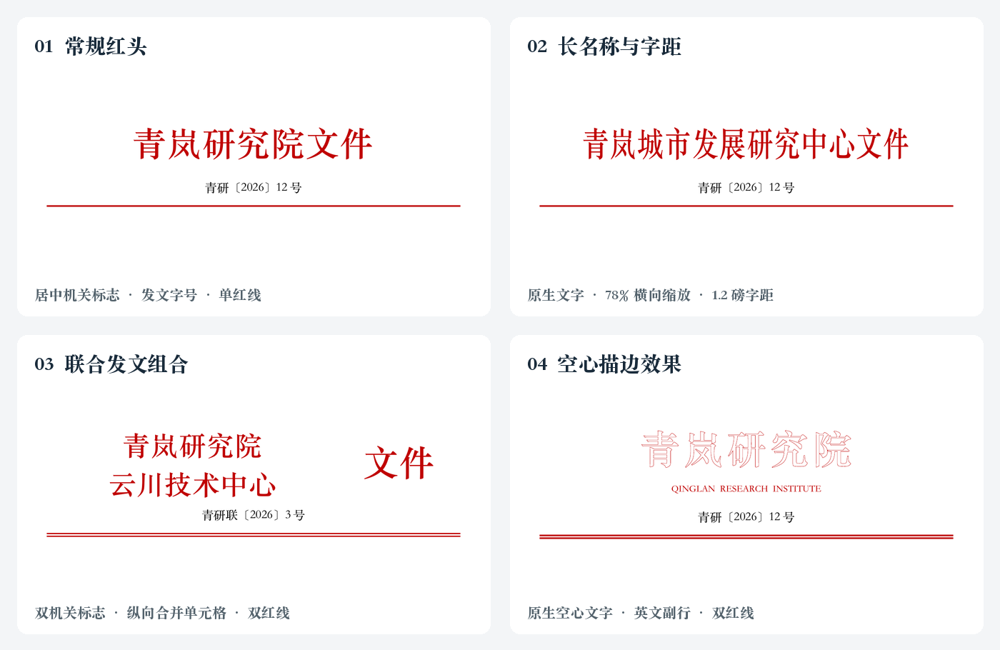

# 红头案例

四个案例展示同一份原创正文迁入不同红头后的效果。名称、文号与内容均为虚构，不使用真实机关标识、印章或外部项目素材。



## 案例与可编辑性

| 案例 | 模板参数 | 原生表示 |
| --- | --- | --- |
| [常规红头](assets/letterheads/01-classic.webp) | 36 磅红字、1 磅字距、居中文号、单红线 | 文字与段落边框 |
| [长名称与字距](assets/letterheads/02-condensed.webp) | 36 磅、78% 横向缩放、1.2 磅字距 | `w:w`、`w:spacing`，文字可直接编辑 |
| [联合发文组合](assets/letterheads/03-joint.webp) | 左列双机关名称 29 磅，右列“文件”38 磅；双红线 | 无边框布局表格、纵向合并单元格、段落边框 |
| [空心描边效果](assets/letterheads/04-outline.webp) | 42 磅、4 磅字距、空心效果、英文副行；双红线 | `w:outline`、普通文字与段落边框 |

底层 DOCX 未将红头栅格化。页面图片仅用于文档展示；案例 03 并非浮动文本框组合，案例 04 并非曲线变形的 WordArt。文字轮廓粗细由渲染器决定。

四例采用 A4、上边距 32 mm、下边距 28 mm、左边距 28 mm、右边距 26 mm，并指定 Songti SC。这里刻意展示不同效果，**不能直接当作 GB/T 9704 合规模板**。正式使用应按适用标准、单位模板和确认的字体重新设定；双线、英文副行、空心字也不自动成为公文规范要求。

## 如何让 Skill 处理类似文档

```text
把这份通知排成所附模板的红头样式，正文不变。
先识别红头到底是普通文字、表格、文本框、艺术字还是图片。
保留模板的字距、横向缩放和分隔线；机关名称及文号使用我提供的信息。
先给我局部效果和完整首页，确认后再迁入其余文档。
```

采访时重点确认：发文机关和顺序、文号及签发人、采用哪份模板、是否允许改动特殊效果，以及是否需要按具体国标条款核验。不要从展示案例中自动带入机关名称或文号。

红头迁入属于独立结构预览；确认预览后才能作为后续格式修订的基线。批量任务仍需代表性样稿确认，最终接受修订另行确认。生成脚本只产生待确认预览，不编造用户批准记录。

## 复现

在仓库根目录安装开发依赖，然后运行：

```bash
python -m pip install -r requirements-dev.txt
python tools/create_letterhead_showcase.py --out out/letterhead-showcase
```

输出目录必须不存在，以免覆盖旧预览。每个案例包含：

- `template.docx`：原创模板，其中一段占位正文应被排除。
- `preview.docx`：实际调用 `component_plan` 与 `preview_component` 后的迁入预览。
- `reference.docx`：独立直接组装的参考排版，不调用组件迁入器。
- `plan.json` 与 `receipt.json`：选择范围、哈希与结构验证记录；保持待确认状态。

公共 `manuscript.docx` 为原稿。生成过程核查原稿哈希不变、未迁入占位正文、包结构验证通过。

用同一渲染器、字体和参数将每组 `preview.docx`、`reference.docx` 分别输出到该组的 `render-preview/`、`render-reference/`，文件命名为 `page-1.png` 等。若使用支持 `--output_dir` 的 `render_docx.py`，可按下面执行；`DOCX_RENDERER` 是本机脚本路径，渲染器不属于本项目运行依赖。

```bash
for case in out/letterhead-showcase/0*; do
  for name in preview reference; do
    python "$DOCX_RENDERER" "$case/$name.docx" --output_dir "$case/render-$name"
  done
done

python tools/export_letterhead_gallery.py out/letterhead-showcase \
  --font /path/to/chinese-font.ttf --out out/letterhead-gallery
```

导出脚本要求每例恰好一页，且参考与预览像素一致；不一致就停止，不会自动发布图集。该比较仅检查**同一渲染环境中的组件迁入效果**，不能证明排版规则正确、指定字体实际命中或跨引擎一致。新环境需要自己检查全部页面，不应仅以导出成功代替视觉审阅。

本次展示使用 bundled LibreOffice 与配置了系统中文字体目录的 Fontconfig；四组完整页面均已逐页视觉检查。原始 DOCX、PDF、记录和中间 PNG 保存在被忽略的 `out/` 中。仓库只纳入原创脚本、说明和精选的展示图片。
